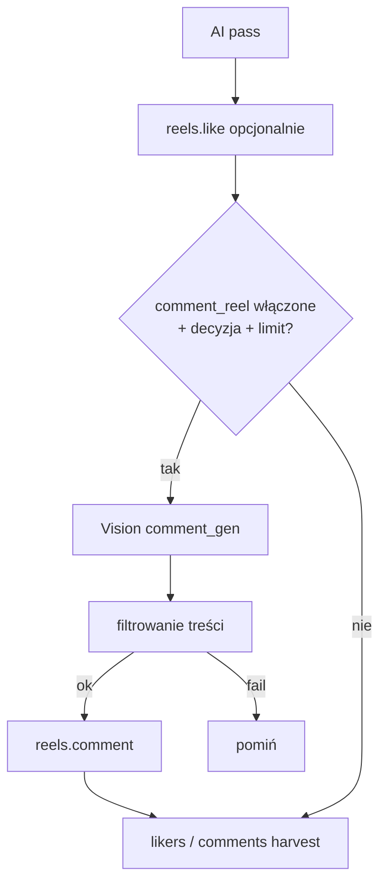
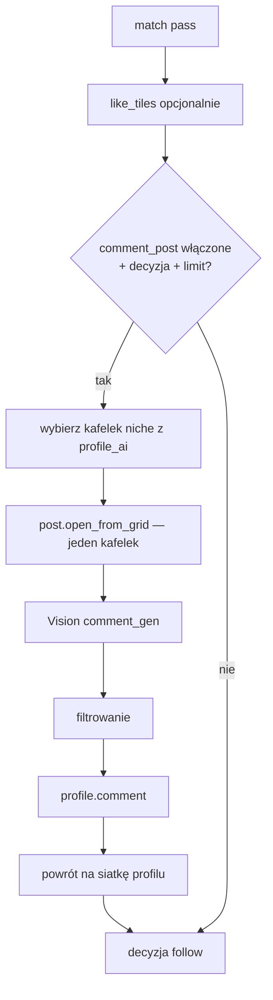

# Komentarze generowane przez AI — reels_niche + profile_interact

## Cel

Bot ma **publikować krótkie, naturalne komentarze tekstowe** pod treściami, które przeszły dotychczasowy pipeline (bramka liczników → ocena AI niszy → opcjonalny lajk), zamiast ograniczać się do lajków, lajkowania cudzych komentarzy i zbierania autorów.

**Reels (`reels_niche`):** po pozytywnej ocenie rolki (i opcjonalnie lajku) bot może zostawić **jeden komentarz pod bieżącą rolką** na feedzie rolek.

**Profile (`profile_interact`):** po pozytywnej ocenie siatki (match) bot może wejść w **jeden wybrany kafelek niszowy**, otworzyć viewer i zostawić komentarz pod postem/rolką na profilu.

Komentarze mają brzmieć jak człowiek z niszy konta — krótkie, bez spamu, bez linków, zgodne z tonem ustawionym w panelu.

---

## Stan wyjściowy (analiza kodu)

### Co już istnieje

| Obszar | Stan |
|--------|------|
| **Ocena treści AI** | `reels.analyze_frames_ai` → `AiVision.run("reel_niche")`; siatka profilu → `profile_grid` |
| **Kontekst rolki w scratch** | `reel`, `reel_caption`, `reel_top_comments`, `reel_composite`, `reel_ai` |
| **Kontekst profilu w scratch** | `profile_header`, `profile_ai`, `profile_decision`, `tiles_liked` |
| **Odczyt top komentarzy** | `reels.read_caption_comments` + `_read_top_comments` (sheet) |
| **Lajkowanie cudzych komentarzy** | `reels.like_comment` — **nie** publikuje własnych |
| **AiVision tryb `comment_gen`** | Stub w `ai/vision.py`; **brak** `ai/prompts/comment_gen.yml`; **brak wywołań** |
| **Limity anty-spam** | `limits.check(kind="comment")` + `daily_comments` / `per_hour_caps.comments` w configu konta; `classify_action` już rozpoznaje kroki `reels.comment` / `profile.comment` (jeszcze nieistniejące) |
| **Model domyślny** | `account.ai.model_per_mode.comment_gen: "sonnet"` w `_template/account.json` |
| **UI komentarzy (probe)** | ID m.in. `layout_comment_thread_edittext_multiline`, `comment_composer_text_view` — potwierdzone w logach `post.open_comments` |

### Czego **nie ma** (luka do wypełnienia)

- Kroki `reels.comment` i `profile.comment` (wpisanie tekstu + submit).
- Prompt YAML `comment_gen`.
- Ustawień w `plugins/catalog.py` dla komentowania własnego tekstu.
- Logiki decyzyjnej „kiedy komentować" (obok istniejącej dla lajka).
- Filtra treści / deduplikacji wysłanych komentarzy.
- Statystyk `comments_posted` w pluginach i `session_stats`.

### Gdzie bot dziś kończy bez komentowania

**`reels_niche._one_reel`** (kolejność po AI pass):

1. `reels.like` (opcjonalnie)
2. `_sheet_block` likers (harvest + hot)
3. `_sheet_block` comments (harvest commenters + **like_comment** + hot)

→ Brak kroku między (1) a (2), który **publikowałby własny komentarz**.

**`profile.visit`** (po match pass):

1. `_like_grid_tiles`
2. `_decide_action` → follow

→ Brak komentowania pod otwartym postem/rolką z siatki.

---

## Zakres

### W zakresie (MVP → rozszerzenia)

| Faza | Zakres |
|------|--------|
| **MVP-1** | Komentarze pod rolką w `reels_niche` |
| **MVP-2** | Komentarze pod postem/rolką z siatki w `profile_interact` |
| **Później** | `content_search` (ten sam blok ustawień co reels); hot_interact z komentarzem; tryb „tylko log" (dry-run) w panelu |

### Poza zakresem (na razie)

- Komentarze w DM / odpowiedzi w wątkach (reply).
- Komentarze pod relacjami (story).
- Zmiany w `core/humanizer.py` (ewentualnie nowy `kind` pause dodany później, bez refactoru profilu).
- Zakładka panelu do podglądu historii komentarzy (wystarczy events.jsonl + logi).

---

## Miejsce w kodzie

### Nowe pliki

```
ai/prompts/comment_gen.yml          # prompt + kontrakt JSON
ai/comment_context.py               # składanie inputs do Vision z scratch (reel vs profile)
ai/comment_filter.py                # filtr bezpieczeństwa przed wysłaniem
steps/reels/comment.py              # reels.comment — publikacja pod rolką
steps/profile/comment.py            # profile.comment — publikacja z viewer profilu
tests/test_comment_gen.py           # prompt, filtr, decyzja
tests/test_reels_comment_step.py    # mock UI
tests/test_profile_comment_step.py
```

### Modyfikacje (implementacja — poza tym planem)

| Plik | Zmiana |
|------|--------|
| `plugins/impl/reels_niche.py` | Sekcja `_maybe_comment_reel()` po lajku; stat `comments_posted` |
| `plugins/impl/profile_interact.py` | Przekazanie `comment_post` w `visit_params`; stat `comments_posted` |
| `steps/profile/visit.py` | Wywołanie komentarza po `like_tiles`, przed follow; limit check |
| `plugins/catalog.py` | Nowe sekcje UI (patrz niżej) |
| `plugins/blocks.py` | Blok `ai_comment()` — wspólny dla obu pluginów |
| `plugins/reel_log.py` | Linie: generowanie / wysłano / odrzucono filtr |
| `plugins/profile_log.py` | Analogiczne linie |
| `steps/registry.py` | Import nowych kroków |
| `ai/vision.py` | `_print_ai_response` dla `comment_gen`; stub z przykładowym tekstem |
| `scheduler/action_estimator.py` | Funkcja `_text_comments()` obok `_comment_likes()` |
| `data/session_stats.py` (plan a48cab80) | Counter `comments_posted` |

### Diagram — reels_niche (docelowa kolejność w `_one_reel`)



### Diagram — profile_interact (`profile.visit`)



---

## Nowe ustawienia w `plugins/catalog.py`

Wspólny blok w `plugins/blocks.py`: **`ai_comment(prefix, *, target="reel"|"post")`** — pola + defaults.

### Sekcja: „Komentarz AI" — `reels_niche`

Klucz główny: **`comment_reel`**

| Klucz | Typ | Domyślnie | Sekcja UI | advanced | Wymagane |
|-------|-----|-----------|-----------|----------|----------|
| `comment_reel.enabled` | bool | `false` | Komentarz AI | nie | — |
| `__ui.comment_decision` | comment_decision (nowy typ UX, wzorzec `like_decision`) | `ai_then_p` | Komentarz AI | nie | ux_only |
| `comment_reel.chance` | chance | `{mode:"formula", value:"score/100"}` | Komentarz AI | tak | — |
| `comment_reel.min_niche_score` | num 0–100 | `60` | Komentarz AI | tak | — |
| `comment_reel.allow_verdict` | multiselect | `["match","partial"]` | Komentarz AI | tak | — |
| `comment_reel.use_top_comments_context` | bool | `true` | Komentarz AI | tak | — |
| `comment_reel.tone` | select | `friendly` | Komentarz AI | nie | — |
| `comment_reel.language` | select | `pl` | Komentarz AI | tak | — |
| `comment_reel.max_length` | num | `150` | Komentarz AI | tak | — |
| `comment_reel.skip_if_commented_author_days` | num | `30` | Komentarz AI | tak | — |
| `comment_ai.enabled` | bool | `true` | Komentarz AI | ukryte gdy steruje comment_decision | — |
| `comment_ai.strictness` | select | `balanced` | Komentarz AI | tak | — |
| `comment_ai.prompt_override` | textarea | `""` | Komentarz AI | tak | — |
| `comment_ai.dry_run` | bool | `false` | Komentarz AI | tak | — |

**Opcje `tone`:** `friendly`, `expert`, `casual`, `supportive`  
**Opcje `language`:** `pl`, `en`, `auto` (auto = język opisu treści)

**`comment_decision`** (nowy widget panelu, analogiczny do `like_decision`):

- `ai_only` — komentuj tylko gdy reel_ai pass (szansa 100% po progu)
- `chance_only` — bez ponownego AI; stała szansa / formuła ze `score`
- `ai_then_p` — bramka AI (werdykt + min score), potem `chance.roll`

Mapowanie: `comment_decision` → `comment_ai.enabled` + `comment_reel.chance` (ten sam wzorzec co lajk).

### Sekcja: „Komentarz AI" — `profile_interact`

Klucz główny: **`comment_post`**

| Klucz | Typ | Domyślnie | Sekcja UI | advanced | Wymagane |
|-------|-----|-----------|-----------|----------|----------|
| `comment_post.enabled` | bool | `false` | Komentarz AI | nie | — |
| `__ui.comment_decision` | comment_decision | `ai_then_p` | Komentarz AI | nie | ux_only |
| `comment_post.chance` | chance | `{mode:"p", value:0.4}` | Komentarz AI | tak | — |
| `comment_post.min_niche_tiles` | num | `1` | Komentarz AI | tak | — |
| `comment_post.pick_strategy` | select | `best` | Komentarz AI | tak | — |
| `comment_post.content_types` | multiselect | `["reels","posts"]` | Komentarz AI | tak | — |
| `comment_post.tone` | select | `friendly` | Komentarz AI | nie | — |
| `comment_post.language` | select | `pl` | Komentarz AI | tak | — |
| `comment_post.max_length` | num | `150` | Komentarz AI | tak | — |
| `comment_post.skip_if_commented_author_days` | num | `30` | Komentarz AI | tak | — |
| `comment_ai.*` | — | współdzielone z reels | Komentarz AI | tak | — |

**Uwaga:** `profile_interact` w wariancie `short=True` (hot z rolek) **nie** komentuje — za drogie i ryzykowne w środku sheet loop.

### Ustawienia konta (bez zmian w catalog — już są)

```json
"limits": {
  "daily_comments": 15,
  "per_hour_caps": { "comments": 4 }
},
"ai": {
  "model_per_mode": { "comment_gen": "sonnet" }
}
```

---

## Prompt AI / kontekst

### Plik: `ai/prompts/comment_gen.yml`

**Tryb:** `comment_gen`  
**Model domyślny:** `claude-sonnet-5` (nadpisywalny przez `account.ai.model_per_mode.comment_gen`)  
**max_tokens:** ~120 (krótki komentarz)

**Placeholdery wejściowe:**

| Zmienna | Źródło |
|---------|--------|
| `{opis_niszy}` `{audiencja}` `{slowa_kluczowe}` `{hashtagi}` | `niche_prompt_fields()` — jak reel_niche |
| `{target_kind}` | `"reel"` \| `"post"` |
| `{autor}` | `@username autora treści |
| `{podpis}` | opis rolki / caption posta (może brakować) |
| `{komentarze_inne}` | top 3–5 cudzych komentarzy (`@nick: treść`) — unikanie powtórzeń |
| `{bio}` | bio profilu (tylko profile_interact) |
| `{ton}` | z ustawienia `tone` |
| `{jezyk}` | `pl` / `en` / `auto` |
| `{max_znakow}` | z ustawienia |
| `{frames}` | opcjonalnie 1 klatka / mini composite (reels) lub screenshot viewer (profile) |
| `{strictness_hint}` | jak w innych promptach |

**Kontrakt odpowiedzi JSON:**

```json
{
  "comment": "tekst komentarza bez cudzysłowów",
  "confidence": 0.0,
  "language": "pl",
  "reasons": ["krótkie uzasadnienie"]
}
```

**Zasady w system prompt (skrót):**

- Max `{max_znakow}` znaków; **bez** URL, **bez** „follow me", **bez** hashtag-spamu.
- Zero wymuszonych @mention; @autor tylko gdy naturalny.
- Nie powtarzaj dosłownie cudzych komentarzy z `{komentarze_inne}`.
- Język: `{jezyk}`; ton: `{ton}`.
- Jeśli treść off-nisza / nie da się sensownie skomentować → `"comment": ""`, `confidence: 0`.

### Moduł `ai/comment_context.py`

Funkcje:

- `build_reel_comment_inputs(ctx, s) -> dict` — czyta scratch po `reels.watch` / AI
- `build_profile_comment_inputs(ctx, s, tile_id) -> dict` — header + opis z viewer
- `recent_comments_for_author(ctx, author, days) -> list[str]` — z events.jsonl lub dedykowany `comments_sent.jsonl`

**Optymalizacja kosztów:** osobne wywołanie `comment_gen` **po** ocenie niszy; nie łączyć z `reel_niche` w jednym call (inny kontrakt JSON). Można pominąć `comment_gen`, gdy decyzja opiera się wyłącznie na istniejącym `reel_ai` i `chance_only`.

---

## Integracja z AI

### Klient

**Użyć istniejącego `AiVision`** (`ai/vision.py`) — tryb `"comment_gen"`.

- Stub: zwraca krótki deterministyczny komentarz (do testów CI).
- Real: Anthropic przez istniejący `_call_anthropic`.
- Usage: `_usage` na wyniku → `accumulate_usage` w pluginie (opcjonalnie sumować w session_stats).

### Obsługa błędów

| Sytuacja | Reakcja |
|----------|---------|
| Brak klucza API / stub | Stub mode; w produkcji log warning |
| `niche_not_accepted` | SKIP (jak analyze_frames_ai) |
| Pusty `comment` / `confidence < min` | SKIP bez UI |
| JSON parse error | SKIP + log `comment_gen_parse_error` |
| API timeout / 5xx | 1 retry z backoff; potem SKIP |
| Koszt | Model haiku opcjonalnie w advanced; domyślnie sonnet z configu konta |

### `dry_run`

Gdy `comment_ai.dry_run=true`: generuj tekst, loguj w terminalu (`reel_log` / `profile_log`), **nie** wołaj kroku publikacji. Przydatne do kalibracji tonu przed live.

---

## Logika decyzyjna

### Wspólny helper: `should_comment(ctx, s, *, score, verdict, scoring=None) -> dict`

Kolejność checków:

1. `comment_*.enabled == false` → skip
2. `limits.check(ctx, "comment")` → `limit_daily` / hourly (propagacja jak przy follow)
3. Autor na `gate.skip_authors` → skip
4. Dedup: autor komentowany w ostatnich N dniach (`skip_if_commented_author_days`) → skip
5. **Decyzja AI / szansa** (comment_decision):
   - `ai_only`: wymaga pass werdyktu + `min_niche_score` / `min_niche_tiles`
   - `chance_only`: `chance.roll()` ze `score` lub `scoring`
   - `ai_then_p`: najpierw pass AI, potem roll
6. (Opcjonalnie) `confidence >= comment_ai.min_confidence` po wygenerowaniu tekstu

### reels_niche — moment decyzji

**Po** `reels.like` (lub po AI pass gdy like wyłączony), **przed** `_sheet_block`:

- Sheet komentarzy do harvestu **nie musi** być otwarty — publikacja z UFI rolki (ikona komentarzy / composer na dole).
- Jeśli `use_top_comments_context=true`, jednorazowo odczytać top komentarze (`capture_reel_caption(open_comments=True)`) **tylko gdy** decyzja positive (oszczędność czasu).

### profile_interact — moment decyzji

**Po** `like_tiles`, **przed** `_restore_header_view` / follow:

- Wybór kafelka: z `profile_ai.tiles` gdzie `should_like` / `category=="niche"`, strategia `pick_strategy` (best / random).
- Wejście: reuse `post.open_from_grid` z `pool=1` i znanym indeksem.
- Po komentarzu: BACK do siatki (`_still_on_profile` guard).

---

## Bezpieczeństwo

### Filtr treści (`ai/comment_filter.py`)

Odrzucaj komentarz gdy:

- Długość > `max_length` lub < 2 znaki
- Zawiera URL (`http`, `www.`, `.pl/`, itd.)
- Więcej niż 2 hashtagi lub 2 @mention
- Dopasowanie do listy `account.niche.exclusions` / `comment_ai.blocked_words` (tags w catalog)
- Duplikat względem ostatnich M własnych komentarzy (Levenshtein / normalizacja)
- Zawiera frazy spamowe (lista domyślna: „obserwuj", „link w bio", „DM", …)

### Anty-spam operacyjny

- **`limits.check` + `note_action`** — już przygotowane w `core/limits.py`
- Domyślne limity konta: 15/dzień, 4/h (konserwatywne na start)
- Cooldown per autor (dedup days)
- **Nigdy** więcej niż 1 komentarz na rolkę / wizytę profilu
- Logować hash treści + autora (nie pełny tekst w events, jeśli polityka prywatności — konfigurowalne)

### Aprobatacja manualna (opcjonalna, faza 2)

- `comment_ai.dry_run` — patrz wyżej
- Rozszerzenie: kolejka `pending_comments.jsonl` + akceptacja w panelu — **poza MVP**

---

## Statystyki i logi

### Liczniki pluginów

| Plugin | Nowy klucz w `stats` |
|--------|----------------------|
| `reels_niche` | `comments_posted`, opcjonalnie `comments_skipped`, `comments_ai_failed` |
| `profile_interact` | `comments_posted`, `comments_skipped` |

### `session_stats` (plan `statystyki_json_i_postęp_a48cab80.plan.md`)

- `counters.comments_posted` — bump po udanym kroku
- `progress.sub.phase = "comment_gen"` / `"comment_post"` przy generowaniu
- `flush()` przy każdej publikacji

### Events (`events.jsonl`)

```json
{
  "kind": "step",
  "payload": {
    "step": "reels.comment",
    "status": "ok",
    "payload": {
      "author": "user_x",
      "text_len": 42,
      "text_hash": "sha256:…",
      "confidence": 0.85,
      "dry_run": false
    }
  }
}
```

`classify_action` → `"comment"` → limiter dzienny.

### Logi operatora

- `reel_log`: „Generuję komentarz…", „Komentarz wysłany (@autor)", „Komentarz odrzucony (filtr: …)"
- `profile_log`: analogicznie z prefixem wizyty

---

## Kroki UI (szkic implementacji)

### `reels.comment`

1. `limits.check("comment")`
2. Tap w `reels.comments_icon` **lub** focus na `comment_composer_text_view` na UFI
3. `humanizer.pause("read_comments")` — już istnieje w profilu pauz
4. Wpisanie tekstu (`device.input_text` / istniejący pattern z `search.type_query`)
5. Tap „Wyślij" / Enter (do kalibracji na A50)
6. Weryfikacja: composer pusty / toast / nowy wiersz na liście
7. `limits.note_action("comment")`; BACK jeśli otwarty sheet

**Wymaga:** wpis w `screen_map` / kalibracja anchorów send + composer.

### `profile.comment`

1. Zakłada viewer otwarty przez `post.open_from_grid`
2. `post.open_comments` (istniejący krok) lub bezpośredni composer w sheet
3. Jak wyżej: wpisz → wyślij → BACK ×2 (viewer → siatka)

**Probe:** rozszerzyć `tools/_probe_comments.py` o flow wpisywania (bez publikacji na produkcji).

---

## Testy

### Jednostkowe

| Test | Co sprawdza |
|------|-------------|
| `test_comment_gen_prompt_loads` | YAML istnieje, placeholdery |
| `test_comment_gen_stub` | `AiVision.run("comment_gen")` zwraca JSON |
| `test_comment_filter_blocks_url` | filtr URL/hashtag |
| `test_should_comment_ai_then_p` | decyzja z mock `reel_ai` + roll |
| `test_limits_classify_reels_comment` | `classify_action` dla step ok |
| `test_visit_params_includes_comment_post` | mapowanie catalog → visit |

### Integracyjne (mock device)

- `reels.comment` z fake hierarchy z composer ID → `StepResult.ok`
- `profile.comment` po fake viewer → skip gdy brak przycisku send

### Manualne (CLI / urządzenie)

1. `comment_ai.dry_run=true` — 5 rolek, weryfikacja tonu w logu
2. `daily_comments=2` — trzeci attempt → `limit_daily`
3. Ten sam autor 2× w sesji → dedup skip

---

## Kolejność wdrażania

### Faza 0 — Przygotowanie (1–2 dni)

- [ ] Napisać `comment_gen.yml` + stub z sensownym tekstem
- [ ] `comment_filter.py` + testy
- [ ] Probe/kalibracja composer + send na docelowym IG

### Faza 1 — MVP reels (2–3 dni)

- [ ] Krok `reels.comment`
- [ ] Blok catalog `comment_reel` + `comment_ai`
- [ ] Podpięcie w `reels_niche._one_reel`
- [ ] `dry_run` + limity + events
- [ ] Testy mock + suchy przebieg

### Faza 2 — MVP profile (2–3 dni)

- [ ] Krok `profile.comment`
- [ ] Sekcja catalog `comment_post`
- [ ] Podpięcie w `profile.visit` + `visit_params`
- [ ] Wybór kafelka z `profile_ai`
- [ ] Testy + live 1 profil/dzień

### Faza 3 — Dopracowanie (1–2 dni)

- [ ] `session_stats` counter (gdy moduł z planu a48cab80 gotowy)
- [ ] `action_estimator._text_comments`
- [ ] Opcjonalnie: `content_search` (reuse bloku `ai_comment`)
- [ ] Dokumentacja w `REELS_NICHE_WORKFLOW.md` + `STAN_SYSTEMU.md`

---

## Ryzyka i otwarte pytania

Poniższe punkty **wymagają decyzji użytkownika** przed implementacją:

1. **Agresywność:** Ile komentarzy dziennie jest akceptowalne na świeżym klonie? (domyślnie 15/4h — czy obniżyć do 5–8 na start?)
2. **Model:** Sonnet vs Haiku dla `comment_gen` — jakość vs koszt (~3–5× więcej tokenów niż ocena niszy).
3. **Język:** Zawsze PL, czy `auto` według opisu treści?
4. **Treść w logach/events:** Pełny tekst komentarza w `events.jsonl` vs tylko hash (RODO / wyciek strategii).
5. **Komentarz vs lajk:** Czy komentować rolekę, której **nie** polubiono (gdy like wyłączony lub roll fail)?
6. **Profile — który post:** Najlepszy kafelek niche vs losowy — wpływ na naturalność.
7. **Hot interact:** Czy kiedykolwiek komentować z hot loop (domyślnie **nie**)?
8. **Manual approval:** Czy MVP wymaga trybu dry-run obowiązkowego przez pierwszy tydzień?

---

## Powiązane plany (bez duplikacji)

- [`statystyki_json_i_postęp_a48cab80.plan.md`](statystyki_json_i_postęp_a48cab80.plan.md) — `comments_posted` w `session_stats.json`
- [`plugin_settings_basic_advanced.plan.md`](plugin_settings_basic_advanced.plan.md) — accordion advanced per sekcja (nowa sekcja „Komentarz AI")
- [`inwentarz_pauz_pluginów_9a3b94ad.plan.md`](inwentarz_pauz_pluginów_9a3b94ad.plan.md) — ewentualny nowy kind `after_comment` (opcjonalnie, nie blokuje MVP)

---

## Uwagi implementacyjne (komentarze w kodzie)

Przy implementacji **dodawać komentarze** wyjaśniające:

- Dlaczego komentarz jest **po** lajku a **przed** harvest (sheet musi być zamknięty / inny flow UI).
- Dlaczego hot `short=True` pomija komentarze.
- Że `comment_composer` na UFI ≠ otwarty panel wątku (lekcja z `read_caption_comments`).
- Spójność z `classify_action` w `limits.py` — krok **musi** nazywać się `reels.comment` / `profile.comment`.
