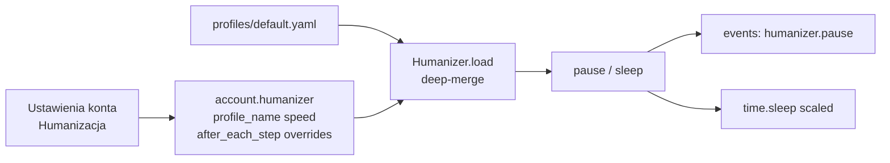

# Humanizer — opcje w UI + logi pauz

## Cel tej iteracji planu

1. **Jak będą wyglądać opcje** w ustawieniach konta → sekcja Humanizacja (pełna lista pól, grupy, etykiety PL).
2. **Każda pauza humanizera** musi być **wyszczególniona w logach** (`events.jsonl` + widoczne w panelu Events).
3. Zachować wcześniejszy kierunek: kindy w YAML, `speed`, `after_each_step`, migracja kluczowych pauz z pluginów.

---

## Jak działają opcje (model dla operatora)



- **Profil bazowy** = domyślne zakresy z YAML.
- **Overrides w koncie** = to, co widać i edytuje się w panelu (nadpisuje YAML).
- **`speed`** = mnożnik tempa nad wszystkimi pauzami ludzkimi (`rzeczywiste = ludzkie / speed`).
- **`after_each_step`** = dodatkowa pauza `between_steps` po każdym kroku atomowym (`stepcall`).

Puste pole override → bierze wartość z profilu (renderer powinien pokazywać **effective** min/max z profilu jako placeholder / podpowiedź w `desc`, albo przy pierwszym otwarciu wypełniać z API profilu — preferowane: przy renderze odczytać profil i pokazać aktualne wartości jako start overrides tylko gdy user zmieni).

**Konwencja UI (jak dziś):** każde pole `type: "range"` = dwa inputy min–max, `unit: "s"`, zapis pod `humanizer.overrides.per_action.<kind>`.

---

## Wygląd sekcji w panelu

Jedna karta SCHEMA (jak dziś), tytuł i opis + **pola w ustalonej kolejności**.  
Grupowanie wizualne: krótkie `field-desc` / etykiety z prefixem grupy w `label` (bez nowego typu „subsection”, żeby nie rozbudowywać renderera — ewentualnie później `type: "heading"` jeśli już łatwo dodać).

**Tytuł karty:** `Humanizacja — tempo i pauzy`  
**Opis:** Zakresy `[min, max]` w sekundach. Losowy czas z zakresu przy każdej akcji. `speed` skraca/wydłuża wszystkie pauzy ludzkie. Settle UI (animacje IG) nie jest tu konfigurowane.

### A. Tempo sesji

| Pole UI (label) | Klucz JSON | Typ | Default | Opis dla operatora |
|---|---|---|---|---|
| Profil bazowy | `profile_name` | select | `default` | Pliki z `humanizer/profiles/*.yaml` |
| Prędkość działania | `speed` | num 0.1–20 step 0.1 | `1` | `2` = pauzy ~2× krótsze (test); `0.5` = wolniej |
| Pauza po każdym kroku | `after_each_step` | bool | `false` | Po każdym atomowym stepie (`stepcall`) dorzuca `between_steps` |

### B. Gesty (krótkie)

| Label | Kind / klucz | Default YAML | Opis |
|---|---|---|---|
| Po tapnięciu | `overrides.per_action.tap` | 0.15–0.4 | Po tap / firm_tap / BACK |
| Po swipe | `overrides.per_action.swipe` | 0.3–0.8 | Po gestach swipe |
| Po klawiszu | `overrides.per_action.key` | 0.1–0.25 | Wpisywanie / ENTER |
| Między krokami | `overrides.per_action.between_steps` | 0.6–1.4 | Ręczne + gdy włączone „po każdym kroku” |

### C. Oglądanie i czytanie

| Label | Kind | Default | Opis |
|---|---|---|---|
| Oglądanie rolki | `watch_reel` | 2–3 | Czas „oglądania” (gdy używane) |
| Oglądanie relacji | `watch_story` | 3–8 | |
| Czytanie opisu | `read_caption` | 2–6 | |
| Czytanie komentarzy | `read_comments` | 5–15 | |

### D. Przerwy między jednostkami pracy

| Label | Kind | Default | Opis |
|---|---|---|---|
| Przed następną rolką | `before_next_reel` | 0.3–0.6 | `reels_niche` przed swipe |
| Między profilami | `between_profiles` | 30–90 | `profile_interact` |
| Między zadaniami kolejki | `between_tasks` | 60–240 | JobRunner między pluginami |
| Między sesjami | `between_sessions` | 1800–3600 | Planner (nie sleep w runtime sesji) |

### E. System (start / stop telefonu)

| Label | Kind | Default | Opis |
|---|---|---|---|
| Po starcie IG | `after_launch` | 2.5–4.0 | |
| Po odświeżeniu | `after_refresh` | 1.5–3.0 | |
| Po wybudzeniu | `after_wake` | 0.6–1.2 | |
| Po odblokowaniu | `after_unlock` | 0.8–1.5 | |
| Przed uśpieniem | `before_sleep` | 0.5–1.0 | |

Pola E: `advanced: true` (jeśli catalog/settings wspierają advanced toggle jak pluginy; jeśli SCHEMA konta nie ma advanced — wszystkie widoczne, z jasnym opisem „rzadko ruszaj”).

### F. Długa przerwa (co N akcji)

| Label | Klucz | Typ | Default | Opis |
|---|---|---|---|---|
| Co ile akcji | `overrides.long_pause.every_n_actions.n` | num | 200 | Licznik `pause()`; `0` = wyłącz |
| Długość przerwy | `overrides.long_pause.every_n_actions` min/max | range | 60–180 | Doklejane do bieżącej pauzy |

---

## Szkic układu (kolejność w formularzu)

```
┌─ Humanizacja — tempo i pauzy ─────────────────────────┐
│ Profil bazowy          [ default ▼ ]                  │
│ Prędkość działania     [ 1.0 ]                        │
│ Pauza po każdym kroku  [ ]                            │
│                                                       │
│ — Gesty —                                             │
│ Po tapnięciu           [0.15] – [0.40] s              │
│ Po swipe               [0.30] – [0.80] s              │
│ Po klawiszu            [0.10] – [0.25] s              │
│ Między krokami         [0.60] – [1.40] s              │
│                                                       │
│ — Oglądanie —                                         │
│ Oglądanie rolki        [2] – [3] s                    │
│ …                                                     │
│ — Przerwy —                                           │
│ Przed następną rolką   [0.3] – [0.6] s                │
│ Między profilami       [30] – [90] s                  │
│ Między zadaniami…      [60] – [240] s                 │
│ Między sesjami         [1800] – [3600] s              │
│                                                       │
│ — System — (advanced)                                 │
│ Po starcie IG / wake / unlock / …                     │
│                                                       │
│ — Długa przerwa —                                     │
│ Co ile akcji           [200]                          │
│ Długość                [60] – [180] s                 │
└───────────────────────────────────────────────────────┘
```

Implementacja: rozszerzyć istniejący blok SCHEMA w [`panel/static/index.html`](panel/static/index.html) (~1400) — te same `type: "range"` / `num` / `bool` / `select`.  
Opcjonalnie dodać `type: "heading"` (readonly label) jeśli render łatwo rozszerzyć; inaczej prefix w `label` (`Gesty · Po tapnięciu`).

---

## Logi — każda pauza wyszczególniona

Dziś `Humanizer.pause` / `sleep` **nie logują** do `events`. Wymóg: **każde** wywołanie ludzkiej pauzy = jeden event.

### Punkt centralny

W [`core/humanizer.py`](core/humanizer.py):

- Dodać opcjonalny `events` / callback `on_pause` ustawiany w `build_context` (albo `humanizer.bind_logger(ctx.log)`), żeby Humanizer nie importował Context cyklicznie.
- `pause(kind, why="")` i `sleep(seconds, why="")` **zawsze** emitują event przed/po śnie.

### Format eventu

```text
kind: "humanizer.pause"
payload:
  pause_kind: "tap" | "between_steps" | "before_next_reel" | ...
  why: "after_step:reels.watch" | "before_next_reel" | ""   # skąd wołano
  drawn_s: 0.32          # wylosowany czas ludzki (przed speed)
  slept_s: 0.16          # realny sleep po scale
  speed: 2.0
  action_n: 47           # licznik akcji humanizera
  long_pause_added_s: 0  # >0 gdy doklejono co-N
  source: "pause" | "sleep"   # API wejścia
```

Dla samego `sleep(t, why=…)` (np. legacy): `pause_kind` może być `"sleep"` albo kind przekazany w `why` — preferowane: dodać opcjonalny `kind=` do `sleep` albo zawsze iść przez `pause`.

### Widoczność

- Zapis: `data/accounts/<id>/events.jsonl` jak reszta.
- Panel Events: event `humanizer.pause` **nie filtrować** (albo osobny filtr „pauzy”); w liście czytelna linia np. `pauza tap 0.18s (×2 → 0.09s)`.
- Opcjonalnie stdout tylko gdy `slept_s >= 1.0` (żeby nie spamować tapami) — **events zawsze**, stdout opcjonalnie.

### Skutek uboczny

Przy `after_each_step` + gestach będzie dużo eventów `tap` / `between_steps` — to zamierzone („wyszczególnione”). Panel musi to znieść (virtualizacja listy już jest / nie blokować SSE).

---

## Migracja kodu (skrót, bez zmiany kierunku)

| Dziś | Docelowo |
|---|---|
| hardcode `before_next_reel` | `pause("before_next_reel")` + log |
| `pause_between_profiles_s` | `pause("between_profiles")`; ukryć w catalog |
| `feed_browser` long_pause catalog | humanizer `long_pause` |
| `between_tasks_s` queue | default z kind `between_tasks`; queue override opcjonalny |
| FlowRunner always `between_steps` | tylko gdy `after_each_step` |
| stepcall | po kroku: `pause("between_steps", why="after_step:<name>")` |

Settle UI (`niche_discover` sleeps) — **poza** tą sekcją i **bez** `humanizer.pause` (żeby nie zaśmiecać logów ludzkich settle’m).

---

## Pliki do ruszania

- [`panel/static/index.html`](panel/static/index.html) — SCHEMA Humanizacja  
- [`humanizer/profiles/default.yaml`](humanizer/profiles/default.yaml) — nowe kindy  
- [`core/humanizer.py`](core/humanizer.py) — log + `after_each_step`  
- [`cli.py`](cli.py) `build_context` — podpięcie loggera  
- [`plugins/stepcall.py`](plugins/stepcall.py), [`runner/flow_runner.py`](runner/flow_runner.py)  
- [`plugins/impl/reels_niche.py`](plugins/impl/reels_niche.py), `profile_interact`, `feed_browser`, [`plugins/runner.py`](plugins/runner.py)  
- [`config/_template/account.json`](config/_template/account.json)  
- testy humanizera + ewentualnie filtr Events w panelu  

---

## Efekt

Operator w **Ustawieniach konta** widzi pełną listę pauz (gesty → oglądanie → przerwy → system → long pause) + speed + przełącznik po kroku.  
W **Events** każda ludzka pauza ma osobny wpis z kindem, czasem wylosowanym i faktycznie przespanym.
