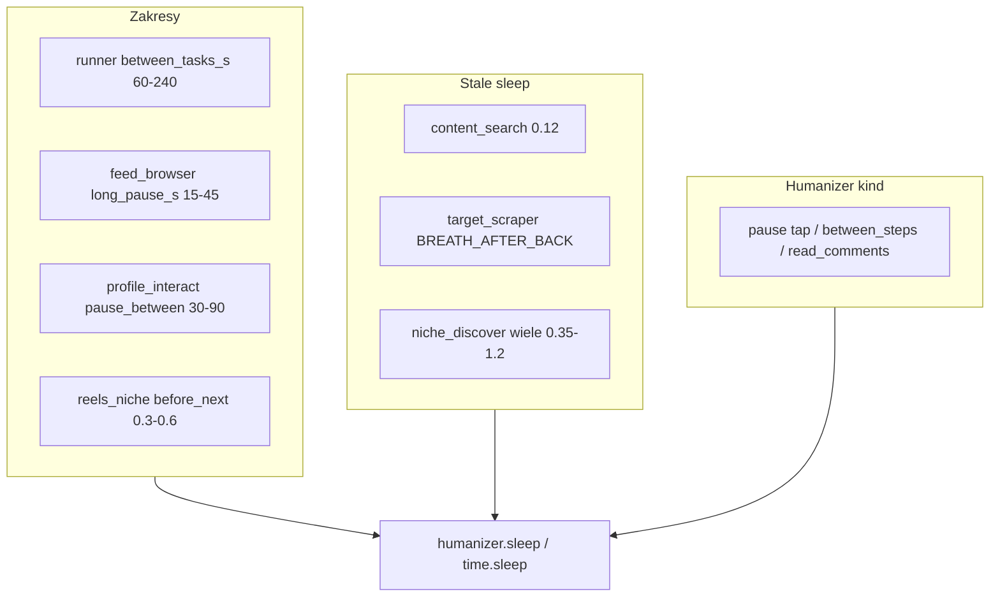

# Inwentarz pauz w pluginach

Po zapoznaniu z docs (`AGENT_ONBOARDING`, `STAN_SYSTEMU`, `REELS_NICHE_WORKFLOW` §11, itd.) — poniżej **wszystkie miejsca pauz czasu** w `plugins/`.

**Klasyfikacja:**
- **Stała** — `time.sleep(N)` z literałem / stałą
- **Zakres (config)** — `{min, max}` z settings/kolejki → `rng.uniform`
- **Zakres (hardcode)** — `rng.uniform(a, b)` wpisany w kodzie
- **Humanizer kind** — `humanizer.pause("…")` (zakres z YAML profilu, nie z pluginu)
- **Skalar config** — jedna wartość z settings (np. `frame_interval_s`), nie zakres

`draw_range` / `Budget.max_items` to **losowanie liczb (ile sztuk)**, nie pauzy czasu — pominięte poniżej.

---

## 1. Zakresy czasu (config / hardcode)

| Plugin / plik | Miejsce | Zakres | Mechanizm |
|---|---|---|---|
| [`plugins/runner.py`](plugins/runner.py) `_pause_between` ~269–287 | między zadaniami kolejki | default **60–240 s** (`plugins/store.py` `EMPTY_QUEUE`) | `between_tasks_s` → `uniform` → `humanizer.sleep` |
| [`plugins/impl/feed_browser.py`](plugins/impl/feed_browser.py) `_long_pause` ~89–95 | co N postów | default **15–45 s**, co **8** (`catalog` `scroll.long_pause_*`) | `long_pause_s` → `uniform` → `humanizer.sleep` |
| [`plugins/impl/feed_browser.py`](plugins/impl/feed_browser.py) + krok `feed.scroll` | dwell między scrollami | default **2.0–7.0 s** (`dwell_fallback_s`) | przekazywane do stepu (pauza w stepie) |
| [`plugins/impl/profile_interact.py`](plugins/impl/profile_interact.py) `_pause_between` ~235–242 | między profilami | default **30–90 s** (`catalog`) | `pause_between_profiles_s` → `uniform` → `humanizer.sleep` |
| [`plugins/impl/reels_niche.py`](plugins/impl/reels_niche.py) ~97 | przed `swipe_next` | **0.3–0.6 s** (hardcode) | `humanizer.sleep(uniform(…), why="before_next_reel")` |

**Defaults w katalogu** ([`plugins/catalog.py`](plugins/catalog.py)):
- `scroll.long_pause_s`: `{min: 15, max: 45}`, `long_pause_every_n: 8`
- `scroll.dwell_fallback_s`: `{min: 2.0, max: 7.0}`
- `pause_between_profiles_s`: `{min: 30, max: 90}`

---

## 2. Pauzy stałe (`time.sleep`)

### [`content_search.py`](plugins/impl/content_search.py)
- ~724, ~750 — `0.12` po BACK (oddech UI)

### [`target_scraper.py`](plugins/impl/target_scraper.py)
- ~459 — `time.sleep(_sheet._BREATH_AFTER_BACK_S)` (stała z `steps/reels/_sheet.py`)

### [`niche_discover.py`](plugins/impl/niche_discover.py) — najwięcej stałych

| Linie (ok.) | Wartość | Kontekst |
|---|---|---|
| 365 | 0.45 | po wyborze zakładki Posty |
| 426 | 0.55 | po zakładce Rolki + `wait_for_stable` |
| 894 | 1.2 | po type_query (sugestie) |
| 905 | 1.0 | retry pick konkurenta |
| 1418 | 0.55 | po swipe (scroll tabs) |
| 1438 | 0.45 | po expand bio |
| 1572 | 0.5 | po swipe reveal grid |
| 1743 | `gap` | między klatkami (`reel_frame_interval_s`, default ≥1.0) — **skalar config**, nie zakres |
| 1807 | 0.4 | po swipe nudge caption |
| 1926 | 0.45 | po swipe pull tabs |
| 1988–1989 | 0.45 / 0.35 | fallback + oddech po BACK |
| 1995 | 0.6 | po `ensure` baseline |
| 2044, 2056 | 0.75 | po tap zakładki grid |
| 2090 | 0.4 | re-check selected tab |
| 2162, 2164 | 0.4 / 0.35 | po expand „więcej” |
| 2217 | 0.55 | po swipe |
| 2249, 2261 | 0.45 | po swipe caption |
| 2564 | 0.4 | BACK z caption |
| 2777 | 0.7 | po tap opisu |
| 2800, 2839 | 0.45 / 0.4 | po expand caption |

### Pluginy **bez** własnych `time.sleep` / zakresów pauz
- [`reels_warmup.py`](plugins/impl/reels_warmup.py) — zero pauz w pluginie (tylko kroki)
- [`mass_stories.py`](plugins/impl/mass_stories.py) — zero pauz czasu (tylko `draw_range` na liczby)

---

## 3. Humanizer `pause(kind)` w pluginach (zakres z profilu YAML)

| Plik | Kind | Gdzie |
|---|---|---|
| `content_search` | `tap` | po swipe results ~614; po BACK ~722, ~748 |
| `profile_interact` | `tap` | `_return_to_search` ~364 |
| `target_scraper` | `tap` / `read_comments` / `between_steps` | harvest sheet ~298–340, ~457 |
| `niche_discover` | `tap` | BACK ~1986, ~2909 |

Zakresy tych kindów żyją w [`humanizer/profiles/`](humanizer/profiles/), nie w pluginie.

---

## 4. Skalary config (jedna wartość, nie min/max)

| Plugin | Klucz | Default | Użycie |
|---|---|---|---|
| `reels_niche` / `content_search` | `frame_interval_s` | 0.5 | param do `reels.watch` |
| `niche_discover` | `reel_frame_interval_s` | 1.0 | `time.sleep(gap)` między klatkami |

---

## Diagram (gdzie powstają pauzy czasu)

---

## Podsumowanie

- **Jawne zakresy pauz w pluginach:** 4 miejsca runtime (`runner`, `feed_browser`, `profile_interact`, `reels_niche` hardcode) + defaults w `catalog`/`store`.
- **Stałe `sleep`:** głównie `niche_discover` (~25+), plus 2× `content_search`, 1× `target_scraper`.
- **`reels_warmup` / `mass_stories`:** brak pauz czasu w warstwie pluginu.
- Pauzy UI w **stepach** (`wait_for_stable_ui`, harvest breathe) są poza `plugins/` — poza tym inwentarzem, chyba że chcesz rozszerzyć mapę.

**Ten plan = raport inwentaryzacyjny; nie przewiduje edycji kodu**, dopóki nie zlecisz np. normalizacji / przeniesienia stałych do configu.