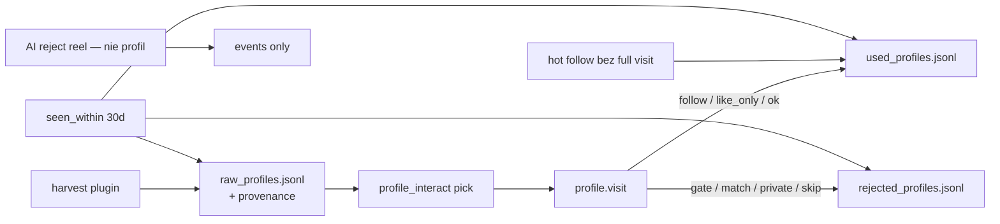

# Provenance profili: raw / rejected / used + okno 30 dni

## Stan dziś (skrót)


| Plik                     | Rola                  | Luka                                                                                                         |
| ------------------------ | --------------------- | ------------------------------------------------------------------------------------------------------------ |
| `raw_profiles.jsonl`     | harvest nicków        | słabe źródło: często tylko `reel_likers`; brak `plugin`, `#`/keyword; rozjazd `from_author` vs `from_target` |
| `visited_profiles.jsonl` | wynik `profile.visit` | ma `action`/`tiles_liked`/`header`, ale bez powiązania z frazą/pluginem harvestu; hot nie oznacza raw        |
| osobny rejected          | **brak**              | gate/match/AI rozproszone (visited outcome / events)                                                         |
| 30 dni                   | częściowo             | `visited_within` + `dedup_days` przy zapisie; reels/content_search często **nie** podają `dedup_days`        |


---

## Propozycja: trzy pliki + jeden indeks czasu

```text
data/accounts/<id>/
  raw_profiles.jsonl       # kolejka / pula — jeszcze nie „domknięte”
  used_profiles.jsonl      # wykorzystane (udana ścieżka interact / follow / like)
  rejected_profiles.jsonl  # odrzucone (gate, match, private, AI, skip…)
```

`visited_profiles.jsonl` **nie kasujemy od razu** — migracja: nowe zapisy idą do `used` / `rejected`; stary plik zostaje do odczytu w checkerze 30 dni (union), potem deprecate.




---

## 1. Provenance przy każdym zapisie do raw

Obowiązkowy blok w wierszu (obok `ts`, `username`):

```json
{
  "ts": "…",
  "username": "anna.k",
  "has_ring": true,
  "provenance": {
    "plugin": "content_search",
    "action": "harvest_likers",
    "list": "reel_likers",
    "query": "#gym",
    "query_kind": "hashtag",
    "from_account": "some_creator",
    "content_kind": "reel"
  },
  "context": {
    "niche_score": 72,
    "verdict": "engage"
  }
}
```


| Pole           | Znaczenie                                                              |
| -------------- | ---------------------------------------------------------------------- |
| `plugin`       | `reels_niche` / `content_search` / `target_scraper` / …                |
| `action`       | `harvest_likers` / `harvest_commenters` / `harvest_followers` / …      |
| `list`         | etykieta listy (dawne `source`)                                        |
| `query`        | `#hashtag`, keyword, nick targetu scrapera                             |
| `query_kind`   | `hashtag`                                                              |
| `from_account` | autor rolki / target scrapera (unifikacja `from_author`/`from_target`) |
| `content_kind` | `reel`                                                                 |


**Kompatybilność:** przy zapisie nadal pisać płaskie `source` = `list` (stary kod/panel). Reader normalizuje legacy → `provenance`.

**Skąd brać w kodzie:** `ctx` + settings pluginu w momencie harvestu — przekazać jako `extra` do `list.harvest_usernames` / `reels.harvest_`* (dziś partial). Wymusić `dedup_days=30` (z configu konta / harvest block) **wszędzie**, także reels_niche i content_search.

---

## 2. `rejected_profiles.jsonl`

Append przy domknięciu negatywnym:

```json
{
  "ts": "…",
  "username": "shop_bot99",
  "reason": "gate_failed",
  "detail": "ratio<0.5,bio_excl:shop",
  "provenance": { "… skopiowane z raw albo z wizyty …" },
  "check": {
    "niche_ran": true,
    "posts_seen": 12,
    "tiles_scored": 9,
    "tiles_liked": 0,
    "like_pct": 0,
    "scoring": 0.21,
    "action": "gate_failed",
    "followed": false
  }
}
```

Powody (`reason`): `gate_failed` | `match_failed` | `private` | `open_failed` | `skipped` | `no_niche` | …

Źródła zapisu:

- `profile_interact` / `profile.visit` przy negatywnym wyniku
- opcjonalnie: sanity/AI profilu (nie mylić z AI-reject **rolki** — to nie jest profil w puli)

---

## 3. `used_profiles.jsonl`

Append przy pozytywnym / częściowo pozytywnym wykorzystaniu:

```json
{
  "ts": "…",
  "username": "roza_angerr",
  "provenance": { "plugin": "reels_niche", "query": null, "list": "reel_likers", "…" },
  "check": {
    "niche_ran": true,
    "posts_seen": 48,
    "tiles_scored": 9,
    "tiles_liked": 2,
    "like_pct": 22.2,
    "scoring": 0.52,
    "action": "like_only",
    "followed": false
  }
}
```

- `like_pct` = `100 * tiles_liked / max(tiles_scored, 1)` (albo `/ posts_seen` — **wybieramy `tiles_scored`**, bo to decyzja AI na kafelkach).
- `niche_ran` = czy odpalono analizę siatki / scoring niszy.
- Hot follow bez pełnego visit: też `used` z `action: "hot_follow"`, `niche_ran: false`, provenance z listy.

Po zapisie used/rejected: `**mark_outcome` na raw** (jak dziś) + opcjonalnie nie kasować wiersza raw (zostaje historia harvestu).

---

## 4. Checker „czy w ostatnich 30 dniach już sprawdzany”

Jeden helper w `[data/stores.py](data/stores.py)`:

```python
def profile_seen_within(account_id, data_root, username, days=30) -> dict | None:
    """Najnowszy hit z used ∪ rejected ∪ (raw z interacted_at) ∪ legacy visited.
    Zwraca {where, ts, reason|action} albo None."""
```

Użycie:

1. **Przy harvest `add_rows`** — jeśli widziany w used/rejected w oknie → nie dodawaj do raw (albo dodaj z flagą `skipped_recent` — **preferowane: nie dodawaj**).
2. **Przy `pick` do interact** — exclude jak dziś `visited_within`, ale przez `seen_within` (used+rejected+visited).
3. **Przy hot open** — ten sam check przed follow/visit.

Default `days=30` z `account.plugins.profile_interact.source.dedup_days` (albo global `humanizer`/account `profile_memory_days`) — jedna gałka.

Indeks wydajności (follow-up ROI): cache nick→last_ts w `scratch` / plik `.index.json`; na start **full scan JSONL** wystarczy (jak teraz).

---

## 5. API sklepów (konkret)

```python
class ProfileLedger:  # cienka fasada
    raw: RawProfilesStore
    used: UsedProfilesStore      # nowy JSONL
    rejected: RejectedProfilesStore  # nowy JSONL

    def harvest(rows, provenance, dedup_days=30)
    def reject(username, reason, check, provenance=None)
    def use(username, check, provenance=None)
    def seen_within(username, days=30) -> Optional[Hit]
```

`VisitedProfilesStore.add` → wewnętrznie mapuje na `use`/`reject` wg `action` (bridge, zero podwójnej semantyki w pluginach na dłuższą metę).

---

## 6. Zmiany w pluginach / stepach (zakres)


| Miejsce                                             | Zmiana                                              |
| --------------------------------------------------- | --------------------------------------------------- |
| `steps/lists/harvest_usernames.py`                  | przyjąć `provenance` dict                           |
| `steps/reels/harvest_likers.py` / `commenters`      | j.w. + `dedup_days`                                 |
| `content_search` / `reels_niche` / `target_scraper` | zbudować provenance (plugin, query, list)           |
| `profile_interact` / `profile.visit`                | po wyniku → `use` lub `reject` z `check.*`          |
| hot loops                                           | `use(..., action=hot_follow)` + `seen_within`       |
| `_example/`                                         | przykłady 3 plików                                  |
| panel `GET /api/raw-profiles`                       | opcjonalnie później: filtry + podgląd used/rejected |


---

## 7. Czego nie robić w tej iteracji

- Promocja do `target_candidates` (osobny ROI).
- Przenoszenie historycznych wierszy visited → used/rejected (tylko forward + union w checkerze).
- DB / Supabase.

---

## Efekt

- W raw zawsze widać: **z którego pluginu, jakiej akcji, jakiego #/keyword/targetu** wziął się nick.
- Odrzuty i sukcesy w **osobnych plikach** z niszą / postami / `like_pct`.
- Przed kolejnym harvestem lub wizytą: **jedno pytanie „widziany ≤30 dni?”** na wszystkich trzech źródłach.

