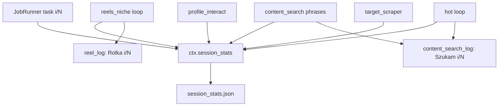

# Statystyki sesji (JSON) + postęp X/Y w logach

## Problem dziś

- [`data/stats.py`](data/stats.py) = **tylko odczyt** historii z `events.jsonl` (CLI `stats`) — nie ma live postępu.
- Lokalne `stats = {}` w pluginach lądują w `PluginResult` / `queue.task_end` **po** zadaniu.
- Ludzkie logi (`reel_log`, `content_search_log`, …) często **bez** `i/N`:
  - `Szukam #gym…` (brak 1/2)
  - `Rolka @x` / `Nastepna rolka...` (brak 2/3)
  - `Hot — 3 z listy lajkujacych` (brak bieżącego 1/3)
- Wzorzec już istnieje częściowo: `viewer_scroll_line(n, total)`, scraper `Post 1/3`, JobRunner `ZADANIE 2/5`.

## Cel

1. **Live JSON** na dysku w trakcie sesji (aktualizowany przy każdym kroku postępu).
2. **Ten sam stan w logu** — każda istotna linia operatora zawiera `current/total` (i kontekst: fraza, rolka, lista).
3. Na razie **bez** nowej zakładki panelu (JSON + stdout/Events wystarczą); historyczny `cli stats` bez zmian kontraktu.

---

## Plik JSON (domyślna lokalizacja)

```text
data/accounts/<account_id>/session_stats.json   # nadpisywany w trakcie sesji
```

Na start sesji (`queue.start` / `build_context`): reset lub nowy obiekt z `session_id`.  
Na koniec zadania: dump finalnych liczników; opcjonalnie kopia:

```text
data/accounts/<account_id>/sessions/<session_id>.json  # snapshot po sesji (append-only archiwum)
```

**Domyślnie w tej iteracji:** jeden live `session_stats.json` + snapshot przy `queue.end` do `sessions/<session_id>.json`.

### Schemat (konkret)

```json
{
  "session_id": "…",
  "account_id": "…",
  "started_at": "ISO",
  "updated_at": "ISO",
  "queue": { "name": "default", "task_i": 2, "task_n": 5 },
  "plugin": "reels_niche",
  "task_id": "…",
  "budget": { "items_done": 2, "max_items": 3 },
  "progress": {
    "phase": "reel",
    "label": "Rolka",
    "current": 2,
    "total": 3,
    "detail": "@user_x",
    "sub": { "phase": "hot_likers", "label": "lista lajkujacych", "current": 1, "total": 3, "detail": "@alice" }
  },
  "counters": {
    "watched": 2, "liked": 1, "likers_saved": 12, "hot_visited": 1
  }
}
```

- `progress` = to, co widać w logu „teraz”.
- `counters` = te same klucze co `PluginResult.stats` (aktualizowane na bieżąco, nie dopiero na końcu).
- `sub` = zagnieżdżony licznik (harvest / hot / scroll w viewerze).

---

## API w kodzie (mały moduł)

Nowy plik np. [`data/session_stats.py`](data/session_stats.py) (nie mieszać z read-only [`data/stats.py`](data/stats.py)):

```python
class SessionStats:
    def begin(session_id, account_id, ...)
    def set_task(plugin, task_i, task_n, budget)
    def set_progress(phase, current, total, label=None, detail=None, sub=None)
    def bump(counter_key, n=1) / set_counters(dict)
    def flush()   # atomic write JSON
    def snapshot_end()
```

Podpięcie:

- `build_context` / `JobRunner.run` → `ctx.scratch["session_stats"] = SessionStats(...)` **albo** pole na `Context` (`ctx.session_stats`).
- Preferowane: **`ctx.session_stats`** na Context (jasne, jak `events`).

`flush()` przy każdym `set_progress` / istotnym `bump` (plik mały; write atomic via tmp+replace).

---

## Logi: wspólny format X/Y

Helper (w każdym `*_log` lub wspólny [`plugins/progress_log.py`](plugins/progress_log.py)):

```python
def xy(current, total) -> str:  # "2/3"
def with_progress(msg, current, total) -> str  # "Rolka @x 2/3"
```

### Docelowe linie (przykłady operatora)

| Miejsce | Linia |
|---|---|
| content_search / scraper — start frazy | `Szukam #gym… 1/2` |
| reels_niche — start / watch rolki | `Rolka @user 2/3` |
| reels_niche — next | `Nastepna rolka… 2/3` (po tick albo przed swipe: jasno **która właśnie skończona / która następna** — ustalamy: **`current` = numer bieżącej jednostki po tick**) |
| content_search — kafelek | `Kafelek 2/8 (reel)` |
| hot follow z listy | `Hot @alice 1/3 z listy lajkujacych` |
| harvest (opcjonalnie przy scrollu) | `Lista lajkujacych — zbieram (limit 20)` — X/Y jeśli znamy limit collect |
| profile_interact | `Wizyta @x 1/5` |
| target_scraper | już ma `Post 1/3` — dopisać do SessionStats + ujednolicić wording |
| JobRunner | już `ZADANIE 2/5` — zapisywać w `queue.task_i/n` |

Zasada: **ten sam `(current, total)` idzie do `say(...)` i do `session_stats.set_progress(...)`** w jednym helperze pluginu, np. `announce_progress(ctx, say_fn, ...)`.

---

## Gdzie podpiąć w pluginach



1. **[`plugins/impl/reels_niche.py`](plugins/impl/reels_niche.py)** — przy starcie jednostki: `items_done+1` / `max_items` → log + JSON; hot: `i/want` + `sub`.
2. **[`plugins/impl/content_search.py`](plugins/impl/content_search.py)** — indeks frazy `p_i/p_n` w `searching_line` / `phrase_start_line`; kafelki `tile_n/want`; hot jak wyżej.
3. **[`plugins/impl/profile_interact.py`](plugins/impl/profile_interact.py)** — wizyta `visited+1` / budget.
4. **[`plugins/impl/target_scraper.py`](plugins/impl/target_scraper.py)** — reuse istniejących `i/want`; sync do SessionStats.
5. **[`plugins/runner.py`](plugins/runner.py)** — `set_task` na starcie/końcu zadania; `snapshot_end` na epilogu.
6. **Log helpers** — rozszerzyć sygnatury:
   - `searching_line(q, i=None, n=None)`
   - `watch_line` / nowa `reel_progress_line(author, i, n)`
   - `hot_profile_line(user, i, n, where)`
   - `visit_start_line(user, i, n)` w `profile_log`

---

## Event (opcjonalnie, lekki)

Przy zmianie `progress` (nie przy każdym tapie):  
`ctx.log("session.progress", **progress_payload)` — żeby panel Events też widział X/Y bez czytania pliku.  
Nie dublować przy każdym `bump` licznika — tylko gdy zmienia się `current` fazy.

---

## Czego nie robimy w tej iteracji

- Przepisywanie [`data/stats.py`](data/stats.py) / zakładki E9 w panelu.
- Agregaty dzienne w live JSON (to dalej z events).
- Statystyki humanizer pause (osobny plan).

---

## Testy

- Unit: `SessionStats.flush` atomic, schemat kluczy.
- Log lines: `searching_line("#a", 1, 2) == "Szukam #a… 1/2"`.
- Plugin mock: po 2 tickach `progress.current == 2` w pliku tymczasowym.

---

## Efekt dla operatora

W trakcie sesji w terminalu/panelu:

```text
  content_search Szukam #gym… 1/2
  reels_niche Rolka @nature 2/3
  reels_niche Hot @alice 1/3 z listy lajkujacych
```

Równolegle plik `session_stats.json` trzyma ten sam stan + sumaryczne `counters` do podglądu / późniejszego UI.
