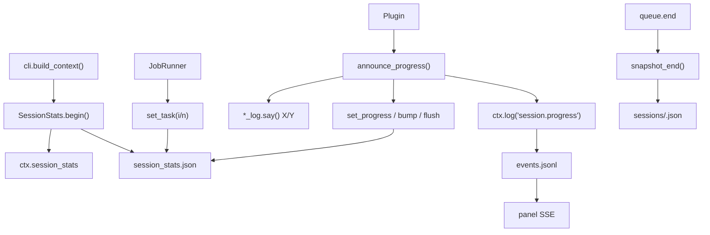

# Plan: Statystyki live sesji

## Cel

Operator widzi bieżący postęp sesji (`X/Y`) w terminalu/panelu oraz w `data/accounts/<id>/session_stats.json`, bez mieszania z historycznym `data/stats.py`.

## Architektura



## Kluczowe pliki

### 1. `data/session_stats.py` (nowy)

Klasa `SessionStats`:

```python
@dataclass
class SessionStats:
    account_id: str
    data_root: Path
    _state: dict
    _on_progress: Callable | None

    def begin(self, *, session_id, queue_name=None)
    def set_task(self, *, plugin, task_id, task_i, task_n, budget)
    def set_progress(self, *, phase, current, total, label=None, detail=None, sub=None)
    def bump(self, key, n=1)
    def sync_budget(self, items_done, max_items)
    def flush(self, *, emit_event=False)
    def snapshot_end(self, *, summary=None)
```

### 2. `runner/context.py`

Dodać pole:

```python
session_stats: "SessionStats | None" = None
```

### 3. `cli.py`

W `build_context` po utworzeniu `ctx`:

```python
from v2.data.session_stats import SessionStats
ss = SessionStats(account_id=account_id, data_root=DATA_ROOT)
ss._on_progress = lambda prog: ctx.log("session.progress", **prog)
ctx.session_stats = ss
```

`ss.begin()` wywołać w `JobRunner.run()` (znany `queue_name`).

### 4. `plugins/runner.py`

- `run()` — `ss.begin(session_id=..., queue_name=...)` po ustaleniu `tasks`
- `_run_task()` — `ss.set_task(plugin=..., task_id=..., task_i=n, task_n=total, budget=...)`
- po `plugin.run()` — `ss.sync_budget(res.items_done, budget.max_items)` + `ss.set_counters(res.stats or {})`
- `_summary()` — `ss.snapshot_end(summary=s)` przed `queue.end`

### 5. `plugins/progress_log.py` (nowy)

```python
def xy(current, total) -> str
def with_progress(msg, current, total) -> str
def announce_progress(ctx, say_fn, *, msg, phase, current, total, label=None, detail=None, sub=None) -> str
```

### 6. Logi X/Y

- `reel_log.py`: `reel_progress_line(author, i, n)`, `next_reel_line(i, n)`, `hot_profile_line(user, i, n, where)`
- `content_search_log.py`: `searching_line(query, i, n)`, `open_tile_line(n, kind, total)`, `hot_profile_line(...)`
- `profile_log.py`: `visit_start_line(username, i, n)`, `next_profile_line(username, i, n)`
- `scraper_log.py`: `target_line(target, i, n)`, `grid_item_line(label, i, n)`

### 7. Pluginy

- `reels_niche.py`: pętla główna → `announce_progress(phase="reel", ...)`, hot → `sub={phase, current, total}`
- `content_search.py`: frazy → `searching_line`, kafelki → `open_tile_line`, hot → `hot_profile_line`
- `profile_interact.py`: wizyty → `visit_start_line`, `ss.sync_budget()`
- `target_scraper.py`: targety → `target_line`, posty → `grid_item_line`

### 8. Panel (opcjonalnie)

Endpoint `GET /api/session-stats/{acc}`:

```python
@app.get("/api/session-stats/{acc}")
def get_session_stats(acc: str):
    p = DATA_ROOT / "accounts" / acc / "session_stats.json"
    if not p.exists(): raise HTTPException(404, "brak aktywnej sesji")
    return JSONResponse(json.loads(p.read_text(encoding="utf-8")))
```

Event `session.progress` trafia do SSE automatycznie przez `ctx.log()`.

### 9. Testy

- `tests/test_session_stats.py`: begin, flush atomic, dedup eventów, snapshot_end
- `tests/test_progress_log.py`: xy, with_progress, announce_progress
- `tests/test_plugins_runtime.py`: FakeCtx z `session_stats`, JobRunner aktualizuje live JSON
- testy linii logów X/Y

### 10. Dokumentacja

- `STAN_SYSTEMU.md`: dodać `session_stats` do Context i danych
- `KOLEJNE_KROKI.md`: E9 = historyczne stats + live stats + widget panelu
- `REELS_NICHE_WORKFLOW.md`: opis X/Y w logach i aktualizacja diagramu

## Efekt końcowy

Terminal / panel Events:

```text
content_search Szukam #gym… 1/2
content_search Kafelek 2/8 (rolka)
reels_niche Rolka @nature 2/3
reels_niche Hot @alice 1/3 z listy lajkujacych
profile_interact Wizyta @bob 3/5
```

Równolegle `session_stats.json` trzyma identyczny `progress` + `counters`, a po sesji snapshot w `sessions/<session_id>.json`.
