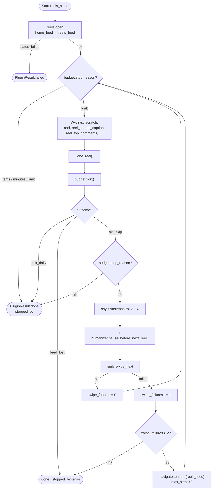
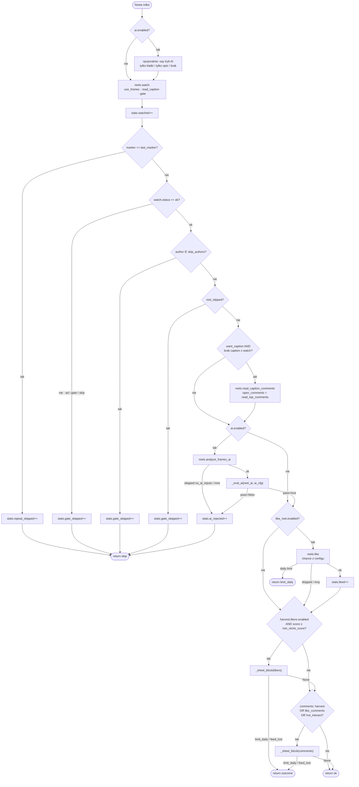
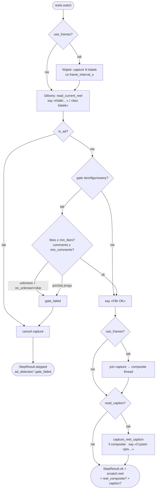
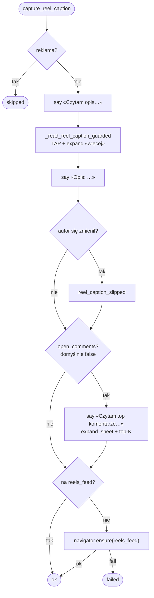
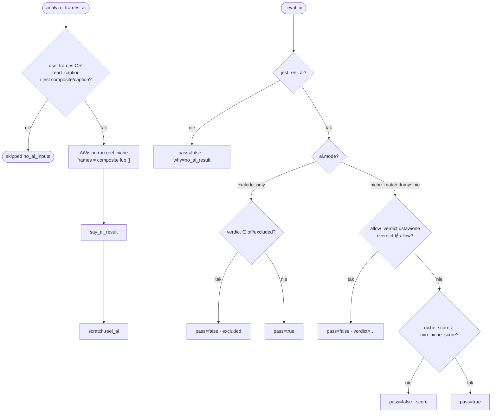
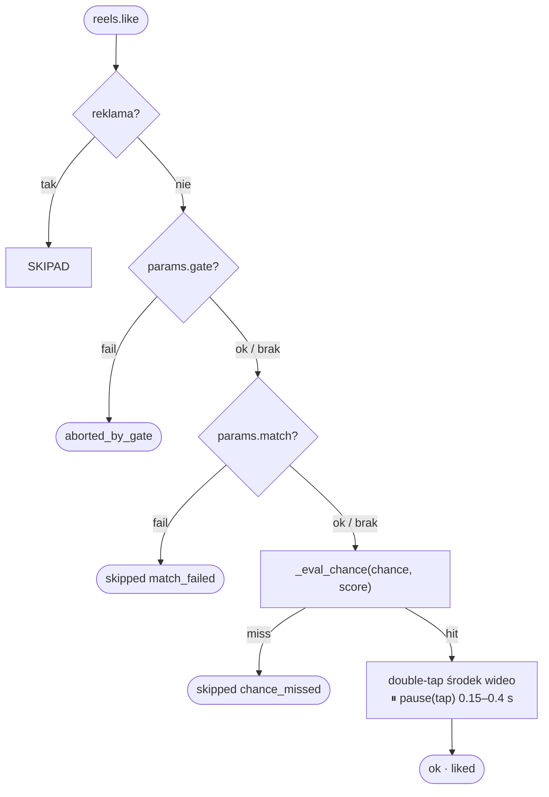
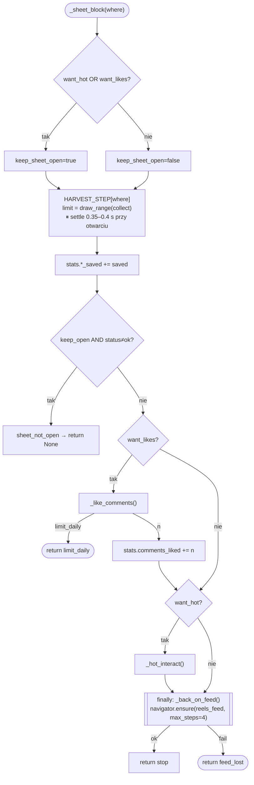
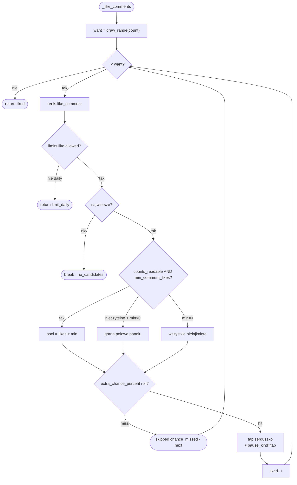
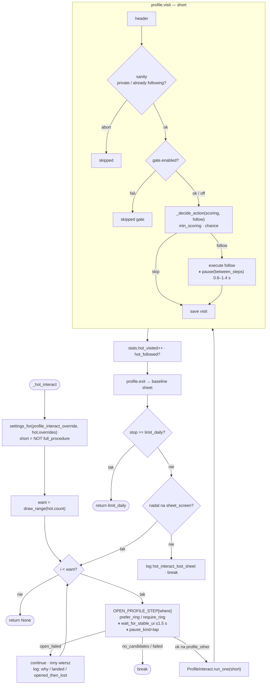
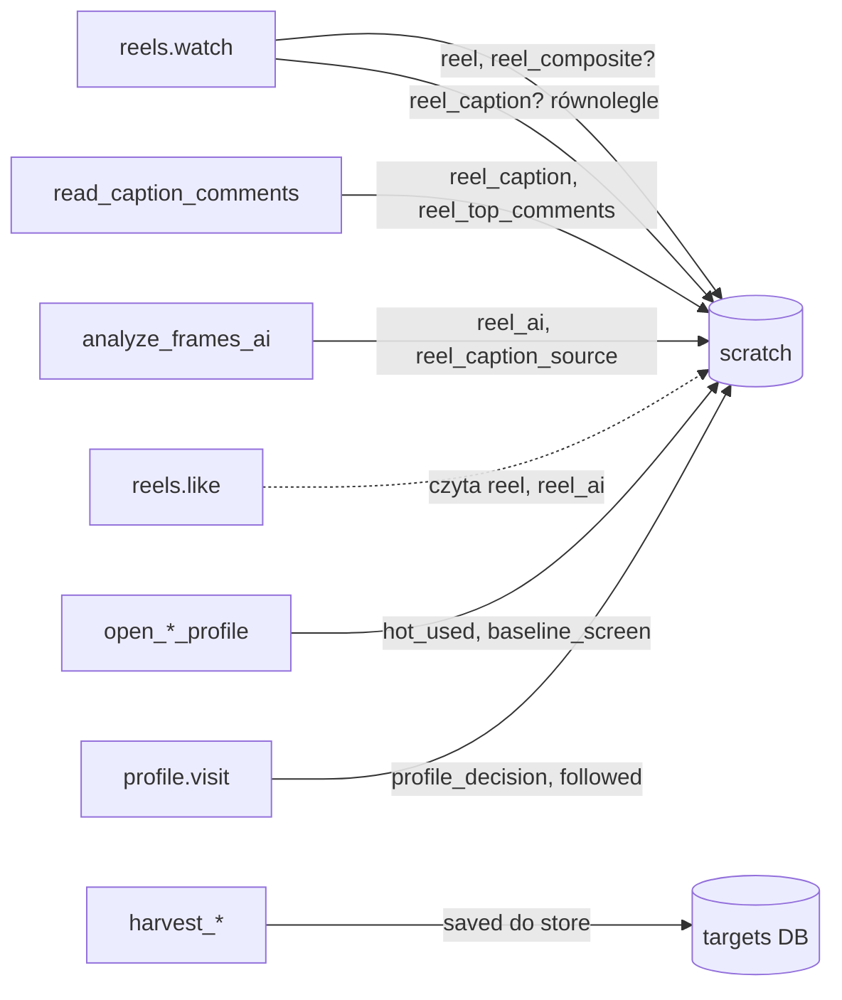

# Workflow: Rolki — nisza (`reels_niche`)

Źródło prawdy: `plugins/impl/reels_niche.py` + kroki `steps/reels/*` + podprocedura `profile_interact.run_one`.
Live logi: `plugins/reel_log.py` (zsynchronizowane z gestami). Pauzy: `humanizer` + stałe settle UI.

Legenda na diagramach:
- romb = decyzja
- prostokąt = akcja / krok
- węzeł `⏸` = pauza
- `stop` = koniec sesji / przerwanie pętli

**Architektura jednej rolki:** klatki ‖ gate → composite ‖ caption → AI → like/harvest → swipe  
Opis przez **tap** (`_read_reel_caption_guarded`), **nie** swipe-caption.

---

## 1. Pętla sesji (plugin `run`)

**Powody `stopped_by`:** `items` · `minutes` · `limit_daily` · `error` (feed_lost / 2× swipe fail).

---

## 2. Jedna rolka (`_one_reel`)

Uwagi:
- Harvest lajkujących: brak progu / brak score (AI off) → `_score_ok` = true.
- Wynik AI w terminalu tylko przez `vision.say_ai_result` (bez duplikatu `ai_ok_line` w pluginie).
- `read_top_comments` domyślnie **false** (kosztowne); na ścieżce analizy zwykle wyłączone.

---

## 2a. Tryby wejść AI (`use_frames` / `read_caption`)

Niezależne flagi w `ai` (katalog: sekcje „Klatki” / „Analiza AI”):

| `use_frames` | `read_caption` | Zachowanie |
|---|---|---|
| true (default) | true (default) | klatki + composite + opis → Vision |
| true | false | tylko obraz (bez caption) |
| false | true | text-only: Vision z `frames=[]`, opis z tap |
| false | false | przy AI ON → skip `no_ai_inputs` |

- `use_frames=false` → `reels.watch` **nie** startuje capture/composite.
- `read_caption` w pluginie jest brane tylko gdy `ai.enabled` (przy AI off opis nie jest czytany).
- `use_frames` działa też przy AI off (zbieranie klatek jak wcześniej).

---

## 3. `reels.watch` — klatki, bramka, opis (równolegle)

W `reels_niche`: `use_watch_duration=false` — N klatek co `frame_interval_s`. `watch_reel` jest dostępny w ustawieniach pluginu, ale używany tylko gdy `reels.watch` pracuje w trybie czasu oglądania.

**Decyzje bramki (`_eval_early_gate`):**
| Warunek | Wynik |
|---|---|
| `is_ad` | skip `ad_detected` |
| `likes < min_likes` | skip `gate_failed` |
| `likes > max_likes` (gdy ustawione) | skip `gate_failed` |
| `comments < min_comments` | skip `gate_failed` |
| wartość `None` + `on_unknown=skip` | skip |
| wartość `None` + `on_unknown=pass` | OK dla tego pola |

`max_likes` jest oceniane we wczesnej bramce `reels.watch` (`_eval_early_gate`),
gdy plugin przekaże je przez wspólne `gate_params` z `plugins/base.py`
(`reels_niche` + `content_search`; 0 / brak = bez górnego limitu).

---

## 4. Opis (+ opcjonalnie top komentarze)

Opis: **ten sam flow co discovery** — `_read_reel_caption_guarded` (TAP w caption / „…więcej”), **bez swipe** po feedzie.

Ścieżki wywołania:
1. **Preferowana:** w `reels.watch` równolegle ze sklejaniem composite (`capture_reel_caption` → `reel_caption_from_watch`).
2. **Fallback:** krok `reels.read_caption_comments`, gdy caption nie wyszedł z watch.

> Discovery i engagement używają **tej samej** ścieżki tap — patrz [`NICHE_DISCOVER.md`](NICHE_DISCOVER.md) §4 / §17.

---

## 5. Live logi (kolejność ≈ gesty)

Typowa ścieżka z AI (oba wejścia ON):

1. `Klatki @autor…` (start watch / capture)
2. `Filtr OK - @autor…`
3. `Czytam opis...` → `Opis: …`
4. `Analiza AI...`
5. wynik przez `say_ai_result`: `score` / `decyzja` / `powod`
6. opcjonalnie `Polubiono @…` / harvest
7. `Nastepna rolka...` → ⏸ `humanizer.pause("before_next_reel")` → swipe

Przy odrzuceniu: pusta linia + `ODRZUT: …` przed „Nastepna rolka…”.

---

## 6. Ocena AI (`analyze_frames_ai` + `_eval_ai`)

Prompt: `ai/prompts/reel_niche.yml` (`max_tokens` ~180).

**Waga sygnałów:** #hashtagi i keywords z opisu mają **większą wagę** niż 2–4 klatki
(próbka z całej rolki). Przy pokryciu tekstowym niszy nie stawiaj `off` tylko na podstawie obrazu.
Stdout: `score` / `decyzja` / `powod` przez `say_ai_result` (bez pełnego promptu).

Domyślnie katalog: `mode=niche_match`, `min_niche_score=55`.

---

## 7. Lajk rolki (`reels.like`) — warstwy w kroku

Plugin woła like z `match={}` (puste) — match AI jest już w `_eval_ai`. W kroku nadal działa szansa:

`chance`: stałe `{p}` albo formuła `{formula: score/100}` (domyślne w katalogu).

---

## 8. Blok sheetu — lajkujący / komentarze (`_sheet_block`)

Jedno otwarcie listy na harvest + like comments + hot. Zawsze `finally` → powrót na `reels_feed`.

---

## 9. Lajkowanie komentarzy (`_like_comments` → `reels.like_comment`)

---

## 10. Hot interact (`_hot_loop` + `profile.visit` short)

Przy `full_procedure=true` short=false → dodatkowo: story (⏸ `watch_story` 3–8 s z ustawień pluginu), grid AI, like tiles.

**Hot open (kod 2026-08-08):** `steps/reels/open_profile_from_sheet.py` + `_sheet.nick_tap_xy` — tap w nick (bias w prawo od ringu), nie w awatar. Poll: `reels_feed` dopiero po **3** kolejnych hitach (mignięcie pod animacją ≠ fail); late `profile_other` = OK; przy zgubionym sheetcie restore (reopen likers/comments) + 1 retry; `why=opened_then_lost` vs brak otwarcia. Hot **nie** mutuje `raw_profiles` (`hot_from_reels`).

---

## 11. Mapa pauz w ścieżce `reels_niche`

| Miejsce | Rodzaj | Domyślny zakres | Uwagi |
|---|---|---|---|
| między klatkami capture | `frame_interval_s` | 0.5 s | gdy `use_frames`; `watch_reel` w ustawieniach pluginu (dla trybu czasu oglądania) |
| opis (tap / expand) | gesty guarded | — | dwell humanizera opcjonalnie w discovery helpers |
| po double-tap lajku | `tap` | 0.15–0.4 s | |
| harvest open / scroll | `tap` + sleep 0.35–0.4 s | | settle listy |
| open profile z sheetu | `wait_for_stable_ui` | ≤1.5 s | + `tap` |
| follow execute | `between_steps` | 0.6–1.4 s | |
| story (tylko full) | `watch_story` | 3–8 s | z ustawień pluginu / `profile_interact` |
| **przed następną rolką** | `before_next_reel` | **0.3–0.6 s** | po komunikacie „Nastepna rolka…”, `humanizer.pause("before_next_reel")` z profilu; przed `swipe_next` (`announce=false`) |
| long_pause globalny | co N akcji humanizera | n=200 · 60–180 s | profil, nie plugin |

**W niszy:** `watch_reel` dostępny w ustawieniach pluginu, ale domyślnie używana jest metoda klatek; `caption_dwell` wyłączony.

---

## 11a. Logi panel / terminal

| Źródło | Co widać |
|---|---|
| `plugins/reel_log.say` | Prefix `reels_niche` — w panelu niebieski (CSS `.ev-plugin`, bez ANSI) |
| AI `reel_niche` | `score` / `decyzja` / `powod` — bez pełnego promptu |
| Hot open fail | `why` / `landed` / `saw_profile` (ludzki log z pluginu) |
| `niche_discover.reel_caption.*` | W `events.jsonl`; **wyciszone w panelu** (nawet gdy engagement używa guarded) |
| Udane kroki `reels.*` | Milczą na stdout (status ludzki z `reel_log`) |
| Navigator L* / identify | Często filtrowane w panelu SSE (mniej szumu przy content_search) |

---

## 12. Przepływ danych (scratch)

Na starcie każdej rolki plugin **czyści** `reel*` ze scratch — żeby opis/AI nie przeciekły do następnej treści.

---

*Źródło prawdy dla `reels_niche` (2026-08-08): klatki∥gate → composite‖opis tap;
`use_frames` / `frame_interval_s` / `read_caption`; `watch_reel` w ustawieniach pluginu;
logi `reel_log`; AI: score/decyzja/powod; #/keywords > sparse frames. Patrz też [`NICHE_DISCOVER.md`](NICHE_DISCOVER.md).*
